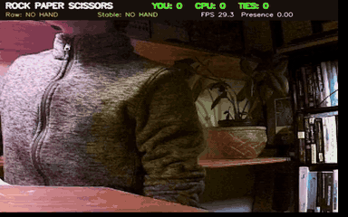

# Rock Paper Scissors

Play Rock Paper Scissors with your hand on a Raspberry Pi 4. The camera captures
your throw and a USB Coral Edge TPU runs the palm and hand landmark models. The
fullscreen view shows the live camera, hand tracking, scores, and round results.

## Demo

[](media/gameplay-demo.mp4)

[Open the full gameplay video with audio](media/gameplay-demo.mp4)

## Set up the Pi

- Raspberry Pi OS with a working camera and `rpicam-vid`.
- A USB Coral accelerator, the Edge TPU runtime, and C++ TensorFlow Lite headers and library.
- A C++17 compiler, Bash, Make, `pkg-config`, OpenCV 4, and Qt 5.14 or newer.

Install the build tools and display libraries if needed.

```bash
sudo apt install g++ make pkg-config libopencv-dev qtbase5-dev
```

Put the two Edge TPU compiled models in `coral_hand_models/` at the repository
root. The program also accepts an absolute model directory in `CORAL_MODEL_DIR`.
The model binaries are supplied separately.

| Model file | Used for |
| --- | --- |
| `hand_detector_int8_edgetpu.tflite` | Finding the palm in the camera frame |
| `hand_landmarks_detector_int8_edgetpu.tflite` | Locating the 21 hand points and estimating hand presence |

From the repository root, build the programs and verify the models on the TPU.

```bash
bash build.sh
./rock_paper_scissors --self-test
```

The build uses `/usr/local/lib/libedgetpu.so.1` by default. Set `EDGETPU_LIBRARY`
to the installed library's full path if yours is elsewhere.

## Play

Run the game from a terminal on the Pi desktop.

```bash
./rock_paper_scissors
```

Hold up a closed fist, lower it three times, and raise it between strokes. The
third lowering starts the three-second countdown. Hold rock, paper, or scissors
when **SHOOT** appears. The result displays briefly before the next round.

| Key | Action |
| --- | --- |
| Space | Start a round manually |
| F | Toggle fullscreen |
| R | Reset scores |
| + / − | Adjust the palm detector threshold |
| Q / Esc | Quit |

## Tracking and performance

The camera requests 640×480 at 30 FPS. A background worker decodes the MJPEG
stream and delivers the latest frame. The tracker refreshes the palm detection
periodically and runs the hand landmark model on the current crop. A candidate
needs a hand-presence score of at least 0.65 and valid landmarks to draw tracking
or participate in a round. A move scores when the current and stabilized
gestures agree.

Use `--profile` to see the camera, game, and paint frame rates and the stage
timings. Use `--palm-interval N` to change the default ten-frame refresh interval.

```bash
./rock_paper_scissors --profile 2>&1 | tee fps.log
```

## Source files

The project C++ source, headers, shell scripts, and tests carry same-line
comments. The bundled SDK and original Coral API header retain their upstream
source and license notices.

| Path | Purpose |
| --- | --- |
| [rock_paper_scissors.cpp](rock_paper_scissors.cpp) | Round state, scoring, camera launch, and game display |
| [hand_tracker.cpp](hand_tracker.cpp) | Coral inference, landmark decoding, gesture classification, and the standalone preview |
| [include](include/) | Frame delivery, model input, tracking, rendering, and start gesture |
| [tests](tests/) | Local checks for tracking, activation, rendering, and model input |
| [VALIDATION.txt](VALIDATION.txt) | Local test results and hardware verification notes |

Run the standalone hand tracker with `./hand_tracker`. Debug the game with
`bash diagnose.sh --profile` when GDB is installed.

## Optional LiDAR probe

The game uses camera tracking. The separate probe reads an RPLIDAR C1 through
its USB serial adapter.

```bash
ls -l /dev/serial/by-id/
./c1_probe /dev/ttyUSB0
```

Use the path of your adapter if it differs. The probe reports valid scan angles
and the nearest return. See the [bundled SDK license](vendor/rplidar_sdk/LICENSE)
and [pinned revision](vendor/rplidar_sdk/PINNED_COMMIT.txt).
